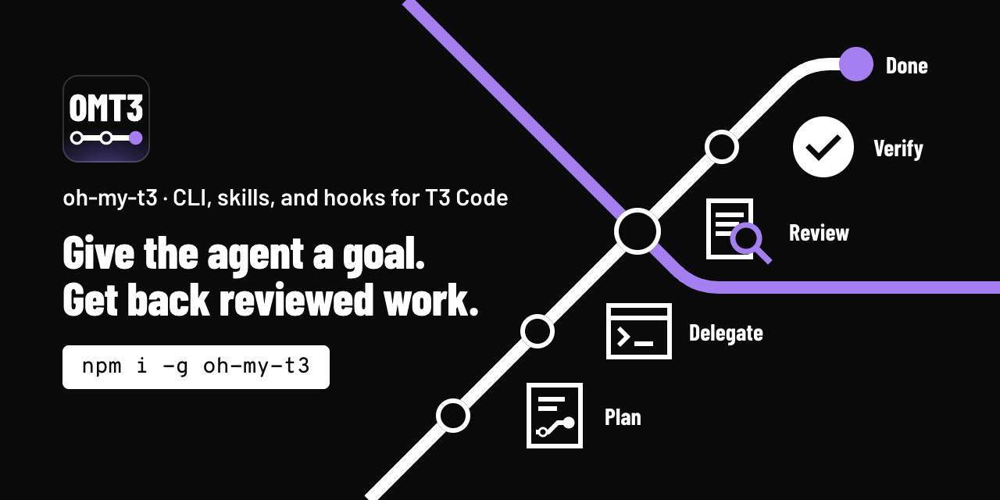

# oh-my-t3code

[](https://www.npmjs.com/package/oh-my-t3code) [](https://github.com/gabimoncha/oh-my-t3code/actions/workflows/ci.yml)

oh-my-t3code adds plans, roles, task briefs, and review loops to the agents that you run in [T3 Code](https://t3.codes). You give the agent a goal, such as `ulw add OAuth to the API`. The agent splits the goal into units, sends each unit to a model as a T3 child task, and then reviews and verifies the result.

## Names

| Name | What it is |
| --- | --- |
| `oh-my-t3code` | The project, the GitHub repository, and the npm package. |
| `omt` | The command that every install gives you. |
| `omt3` | The same npm package under a short name, for one-shot runs: `npx omt3` or `bunx omt3`. Another project owns the npm name `omt`, so `npx omt` runs that project. |
| `omt-ulw`, `omt-plan`, and the other `omt-*` names | The skills that the agent runs. |

## Install

Install the `omt` command with one of these commands:

```sh
npm i -g oh-my-t3code                        # needs Node 22 or later
mise use -g github:gabimoncha/oh-my-t3code   # release binary, needs no Node
```

To check the install, run `omt --version`. If your shell does not activate mise, run `mise exec -- omt --version`.

By default, mise skips a release in its first 24 hours (the `minimum_release_age` setting). To install a new release at once, pin its version, such as `github:gabimoncha/oh-my-t3code@0.1.0`.

To run omt once with no install, use `npx omt3` or `bunx omt3`:

```sh
npx omt3 --version
bunx omt3 --version
```

Then install omt into your project:

```sh
cd /path/to/your-project
omt install --project --hooks
omt doctor --project
```

The install lists the files that it will write and asks before it writes them. It hides these files from git. It also checks which harnesses you can run, Claude Code and Codex. When one is missing, the new config gets a `"harnesses"` key that skips the models of the missing harness. `--hooks` adds the `ulw` keyword to Claude Code. If you use only Codex, leave `--hooks` out. `doctor` must print no `FAIL` line.

Restart the T3 agent sessions of the project. A running session does not load new skills.

The [install guide](docs/install.md) shows the other channels (pnpm, Bun, dev dependency, and an install for all projects), the files that each install writes, and the uninstall.

To let your coding agent do the install, paste this prompt into Codex or Claude Code in your project:

```text
Install oh-my-t3code (omt) for this project. Follow
https://github.com/gabimoncha/oh-my-t3code/blob/main/docs/agents/quickstart.md
step by step, run the check at the end of each step, and tell me what to restart.
```

## Who it is for

Use omt if you use T3 Code and want an agent to plan and finish work that has several steps. With both Claude Code and Codex, a model of one family reviews the work of the other family. You can read the plan, the task count, and each review verdict in files under `.omt/`.

Do not use omt in these cases:

- You do not use T3 Code. The skills start child tasks with the T3 `delegate_task` tool, and only a T3 thread has that tool.
- You want a quick edit with no plan and no review. omt runs its full loop also for small tasks, and each unit costs about 5 child tasks.
- You want a hosted service or a scheduler that runs in the background. omt has neither.

## Requirements

- The latest [T3 Code](https://t3.codes) release. omt is tested only on the latest release.
- Claude Code, Codex, or both, enabled in T3 under **Settings** > **Providers**. Design and UI work needs Claude Code.
- git.
- Node 22 or later for the npm package. The release binary needs neither Node nor Bun.

Use a patched supported Node release for the npm package: 22.23.4 or 24.22.1 LTS.
[Bun 1.4.4](https://bun.com/blog/bun-v1.4.4) blocks the compromised emSign intermediate keys. Rebuild release binaries with this version to include the fix.

## First run

In a T3 thread, type:

```text
$omt-ulw add rate limiting to the public API
```

T3 changes `$omt-ulw` to the syntax of each provider, such as `/omt-ulw` in Claude Code. With the Claude Code hook, the keyword alone works: `ulw add rate limiting to the public API`.

The agent reads the code, writes a plan in `.omt/plans/`, and sends each unit to a child task. In the default `normal` profile, a model from the other family reviews each unit. A large run also verifies each unit, and a final review checks the whole change.

After an install for all projects, run `omt init` in the project first.

If you do not know what to do next, type `$omt-help`. To change the setup, type `$omt-setup`.

## Skills

| Skill | Use it when |
| --- | --- |
| `omt-ulw` | You want a task built, fixed, or shipped from start to end. The `ulw` and `ultrawork` keywords start it. |
| `omt-plan` | You want a reviewed plan before any code changes. |
| `omt-grill` | Your goal is vague, or you want its edge cases and open questions found before a plan. |
| `omt-design` | You want designs or mockups before UI work. |
| `omt-review` | You want a review of uncommitted changes, a branch, a commit, or a pull request. |
| `omt-research` | You need an answer with sources from the repository, library docs, or the web. |
| `omt-help` | You want to know what omt can do, what to do next, or how to do something. It only reads and changes nothing. |
| `omt-setup` | You want omt set up, configured, or updated: the harnesses, the default set, models, roles, or profiles. It asks before each write. |
| `omt-swarm` | You have independent tracks, and each needs its own worktree thread and pull request. |
| `omt-loop` | Work must continue across turns until a check passes. |
| `omt` | You want the list of workflows and CLI commands. |

The agent can start the first eight skills itself. You start `omt-swarm`, `omt-loop`, and `omt` by name.

A plan and its ledger stay in `.omt/` after context compaction and across sessions, so one plan can run for days. A profile in `.omt/config.jsonc` can change the models, the checks, and the limits. See [Configure roles and profiles](docs/configuration.md), or ask `$omt-setup` to make the change.

## Worktree setup

A new T3 worktree has no `node_modules`. `omt worktree setup` writes a T3 setup script that installs the dependencies before the agent starts. All worktrees share one global package store.

```sh
omt worktree check
omt worktree setup --dry-run
omt worktree setup
```

The setup works with Bun and pnpm, and never overwrites a file. Commit the new files on the branch that new worktrees start from. Then import `Setup` from `t3.json` in T3 **Project Settings**. The [install guide](docs/install.md#set-up-new-worktrees) has the details.

## How it works

omt has two parts. The skills tell the agent how to plan, delegate, review, and verify. The `omt` CLI does the steps that must give the same result each time: it merges the config, picks a model for each role, writes the task briefs, and counts the tasks in the ledger. The CLI has no runtime dependencies. The CLI sends no telemetry. It contacts the npm registry only when you run `omt update`, or once a day in `omt install` and `omt doctor` after you set `update` in the user config. `omt update` runs the package manager or mise command of the channel that installed omt.

T3 gives each agent session tools to start, check, and cancel child tasks on any provider and model. Each child task is a T3 thread, so you can watch it in T3. omt adds roles, model routing, briefs, review loops, and limits. It does not change T3.

Each role, such as `execute` or `review`, has an ordered list of models. If T3 refuses the first model, the agent uses the next one. When both families are available, the reviewer comes from the other family than the worker. `omt roles` shows the model of each role.

The [walkthrough](docs/walkthrough.md) follows two real runs on this repository. One run had 4 units and used 29 child tasks in 2 hours 20 minutes. The other had 10 units and used 128 child tasks over 5 days.

## Glossary

- Conductor: the T3 thread that runs an omt skill. It writes the plan, starts the child tasks, and reads their results.
- Unit: one part of the plan, with a role, a file scope, a done condition, and a verify command.
- Brief: the full task text that a child task gets.
- Ledger: `.omt/ledger.jsonl`, with one line for each task start and each result.
- Profile: a named set of workflow switches, limits, and role changes. The built-in profiles are `normal`, `prototype`, and `pr-review`.
- Oracle: a final review of the whole change.
- LIGHT and HEAVY: the two run sizes. A LIGHT run has one or two units in one area of code. Every other run is HEAVY and gets a reviewed plan.

## Limits

- This is version 0.3. The config format and the CLI output can change.
- A run can start 24 child tasks by default, which is enough for 3 to 4 units. To raise the limit, run `omt plan limit <slug> --tasks <n>`.
- The `ulw` keyword works only in Claude Code. In Codex, type `$omt-ulw`.
- `omt-swarm` needs a thread in `full-access` runtime mode and `default` interaction mode.
- Child tasks share the checkout of the parent thread. Units that edit files run in parallel only when their files do not overlap.
- If you use Codex child tasks, [set the Codex unload delay](docs/install.md#set-the-codex-unload-delay). Codex 0.163.0 keeps each finished child loaded for 30 minutes by default.

## Docs

- [Install guide](docs/install.md)
- [Release guide](docs/releasing.md)
- [Configure roles and profiles](docs/configuration.md)
- [How the workflows run](docs/workflows.md)
- [Commands](docs/commands.md)
- [Docs index](docs/README.md): the spec, the design notes, and the research notes.

## Credits

oh-my-t3code uses ideas from [oh-my-openagent](https://github.com/code-yeongyu/oh-my-openagent) (fallback chains, the ultrawork loop, plan reviews), [oh-my-pi](https://github.com/can1357/oh-my-pi) (model roles and the review recipe), and [T3 Code](https://github.com/pingdotgg/t3code) (orchestrator v2, which runs the child tasks). The license of oh-my-openagent does not allow copies of its code or prompts, so oh-my-t3code copies neither.

## License

MIT. See [LICENSE](LICENSE).
