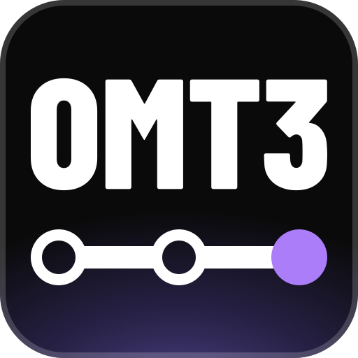
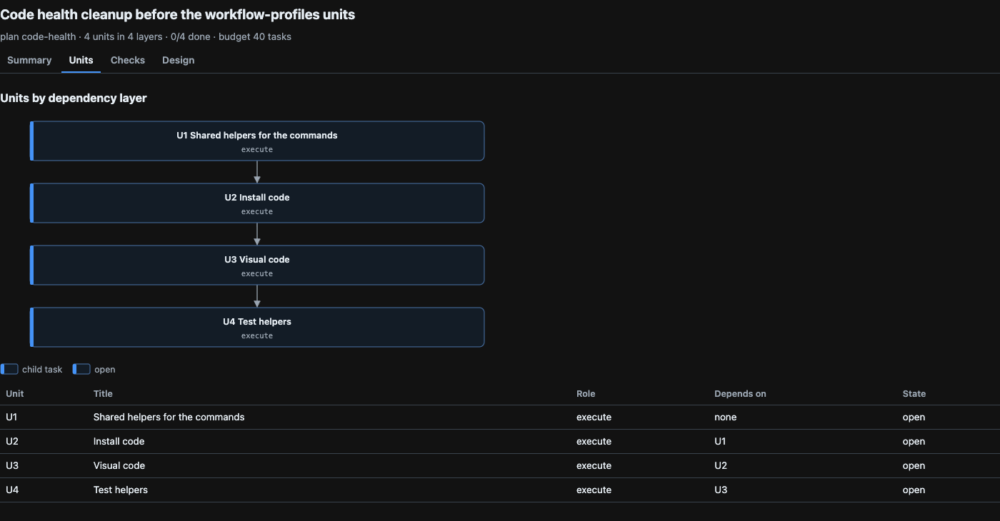

# oh-my-t3code

oh-my-t3code (`omt`) adds plans, roles, task briefs, and review loops to the agents that you run in [T3 Code](https://t3.codes). You write one sentence, such as `ulw add OAuth to the API`. The agent splits the work into units, sends each unit to a model as a T3 child task, and reviews and verifies the result.

## Who it is for

Use omt if:

- You use T3 Code and want an agent to plan and finish multi-step work with subagents.
- You have Claude Code, Codex, or both, and want one model family to review the work of the other.
- You want the plan, the task count, and the review verdicts in files that you can read.

Do not use omt if:

- You do not use T3 Code. The skills start child tasks with the T3 `delegate_task` tool, which works only in a T3 thread.
- You want a quick edit with no plan and no review. omt runs its full loop also for a small task, and each unit costs about 5 child tasks.
- You want a hosted service or a background scheduler. omt adds no server and no daemon.

## Requirements

- [T3 Code](https://t3.codes) v0.1.0 or later. It is free, for macOS, Windows, and Linux.
- Claude Code (`claude auth login`), Codex with a ChatGPT sign-in, or both. Enable them in T3 under **Settings** > **Providers**.
  - With both, a model from the other family reviews each change. With one, the same family reviews its own work.
  - The `design` and `ui` roles run only on Claude. Without Claude Code, omt cannot do design or UI units.
- Node.js 22.18 or later, and git.
- pnpm, only for the global install.

## For agents

To let your coding agent install omt, paste this prompt into Codex or Claude Code in your project:

```text
Install oh-my-t3code (omt) for this project. Follow
https://github.com/gabimoncha/oh-my-t3code/blob/main/docs/agents/quickstart.md
step by step, run the check at the end of each step, and tell me what to restart.
```

The [agent quick start](docs/agents/quickstart.md) checks the fit, installs omt for one project, and lists the first tasks to try.

## Quick start

Install omt into one project. The install writes only inside the project, hides its files from git, and needs no `pnpm install`.

```sh
git clone https://github.com/gabimoncha/oh-my-t3code.git ~/src/oh-my-t3code
cd /path/to/your-project
node ~/src/oh-my-t3code/src/cli.ts install --project --hooks
node ~/src/oh-my-t3code/src/cli.ts doctor --project
```

The install shows what it will write and asks before it writes. `--hooks` adds the `ulw` keyword for Claude Code. If you use only Codex, leave it out. Doctor prints one line for each check. Expect `PASS` lines and no `FAIL` line. A `WARN t3` line means that doctor found no T3 Code settings file.

Then restart the agent sessions of this project in T3 Code. A running session does not load new skills.

To install omt for all your projects, run `pnpm install`, `pnpm build`, and `pnpm link --global` in the clone, and then `omt install`. The [install guide](docs/install.md) has these steps, every path that each install writes, and the uninstall.

## First run

In a T3 thread, start the ultrawork loop:

```text
$omt-ulw add rate limiting to the public API
```

T3 changes `$omt-ulw` to the form of each provider: `/omt-ulw` for Claude Code and Cursor, `/skill:omt-ulw` for Pi, and `$omt-ulw` for Codex. With the Claude Code hook, the keyword is enough: `ulw add rate limiting to the public API`.

The agent explores the code, writes a plan in `.omt/plans/`, and sends each unit to a child task. The profile sets the checks. In the default `normal` profile, a model from the other family reviews each unit. For a HEAVY run, a verifier also runs each unit, and a final oracle reviews the whole change.

After a global install, run `omt init` in the project first. It creates `.omt/` with a project config and a `.gitignore` for the plans and the ledger.

## Worktree setup

A new T3 worktree has no `node_modules`. omt can create a setup script that installs the dependencies before the agent starts, with packages from one global store that all checkouts share.

```sh
omt worktree check
omt worktree setup --dry-run
omt worktree setup
```

- `setup` writes only missing files: `t3.json` with a blocking `Setup` script, the runner `.t3/omt-worktree-setup.mjs`, and for pnpm a `pnpm-workspace.yaml` with `enableGlobalVirtualStore: true`. It never rewrites an existing file. When an existing file blocks the setup, or the project selects a linker other than `isolated`, it stops and tells you what to change.
- At each run, the runner finds the package manager from `package.json` and the lockfile, so a later change from pnpm to Bun needs no new runner. It needs Bun 1.3.14 or later, or pnpm 10.12.1 or later. It installs no package manager.
- The runner does a frozen install with the isolated linker into the global virtual store. A package manager can keep some packages local, for example patched packages. pnpm before 11.23 can turn off the global store in CI.
- The files do nothing until T3 runs them. Commit them on the branch that new worktrees start from. Then, in T3 **Project Settings**, import `Setup` from `t3.json` and keep the inherited scripts. `omt worktree check` cannot see whether T3 runs the script.

This repository has these files. Their T3 import waits until the files are on the base branch.

## What a run looks like

The [walkthrough](docs/walkthrough.md) follows two runs on this repository. It uses their plan files, their ledgers, and `git log`.

- `code-health` had 4 units and used 29 child tasks in 2 hours 20 minutes. The plan needed 3 review rounds. The first oracle reopened one unit, and the second oracle approved. The run removed 353 lines of TypeScript, and all 521 tests passed.
- `workflow-profiles` had 10 units and used 128 child tasks over 5 days, from 2026-10-09 to 2026-10-17. The plan file and the ledger kept the state between sessions.



## What omt does today

| Mode | What omt does | How to start it | Limit |
| --- | --- | --- | --- |
| Loop | `omt-loop` keeps a plan going across turns until a condition command reports done. | Type `$omt-loop`. | No tool can set a T3 goal. On Claude and Codex threads, you type `/goal <objective>`. Other providers use a scheduled heartbeat. |
| Graph | Each unit of a plan lists the units that it depends on. `omt plan status <slug>` prints a `ready:` line with the open units whose dependencies are done. `omt visual` and `omt-show` draw the units as a flowchart. | `$omt-ulw` or `$omt-plan` writes the plan. | No scheduler process runs. The conductor starts the ready units on its own turns. Units run in parallel only when their files do not overlap. |
| Swarm | `omt-swarm` splits work into independent tracks. Each track runs `omt-ulw` in its own T3 worktree thread and ends in a pull request. | Type `$omt-swarm`. | The thread must run in `full-access` runtime mode and `default` interaction mode. Tracks share no files. Uncommitted edits stay in your checkout. |
| Zero-to-one | The plan and the ledger in `.omt/` stay after context compaction and in new sessions, so one plan can run for days. | `$omt-ulw <goal>`. A HEAVY goal gets a reviewed plan first. | A run can start 24 child tasks by default, enough for 3 to 4 units. To raise the budget, run `omt plan limit <slug> --tasks <n>`. |
| Custom agents and workflows | A custom role has its own model chain and persona. A profile extends a preset, turns workflow steps on or off, and overrides roles, models, and limits. | Add roles and profiles to `.omt/config.jsonc`, as [Configure roles and profiles](docs/configuration.md) shows. Then run `$omt-ulw --profile <name> <task>`. | A profile cannot add a step or change the order of the steps. |

## Skills

| Skill | Use it when |
| --- | --- |
| `omt-ulw` | You want a task built, fixed, or shipped end to end with subagents. The `ulw` and `ultrawork` keywords start it. |
| `omt-plan` | You want a reviewed plan before any code changes. |
| `omt-design` | You want designs, mockups, or screens before UI work. You pick and steer the screen variants. |
| `omt-review` | You want a review of uncommitted changes, a branch, a commit, or a pull request. |
| `omt-research` | You need a cited answer from the repository, library docs, or the web. |
| `omt-show` | You want to see a plan, a flow, or a status as a page with flowcharts and tables. |
| `omt-swarm` | You have independent tracks that each need their own worktree thread and pull request. |
| `omt-loop` | Work must continue across turns until a condition holds. |
| `omt` | You want the list of workflows, the CLI commands, and the shared references. |

The agent can start the first six skills on its own. You start `omt-swarm`, `omt-loop`, and `omt` by name.

## How it works

omt has two parts:

- Skills tell the agent how to plan, delegate, review, and verify.
- A small CLI, `omt`, does the deterministic parts. It merges the config, picks a model for each role, renders the task briefs, and counts the plan and ledger state. It has no runtime dependencies, makes no network calls, and sends no telemetry.

T3 orchestrator v2 gives each agent session tools to start child tasks on any provider and model, to check and cancel them, and to read the model catalog. Each child runs as a T3 thread, so the T3 UI shows its progress and its result. T3 does not give roles, model routing, briefs, review loops, or limits. omt adds them on top of the T3 tools and does not change T3.

Each role, such as `execute` or `review`, has an ordered list of models. When T3 refuses the first model, the agent uses the next one. The reviewers come from the other model family than the worker: GPT-6-Astra reviews Claude work, and Claude Opus 5.5 reviews GPT work. Run `omt roles` to see the model of each role.

## Glossary

- Conductor: the T3 thread that runs an omt skill. It writes the plan, starts the child tasks, reads their results, and decides what runs next.
- Unit: one part of the planned work. It has a role, a file scope, a done condition, a verify command, and its dependencies.
- Brief: the complete task text that a child gets. `omt brief` renders it.
- Ledger: `.omt/ledger.jsonl`. It has one line for each dispatch and each result. omt counts the task budget from it.
- Profile: a named set of workflow switches, limits, and role overrides. The presets are `normal`, `prototype`, and `pr-review`.
- Oracle: a final review of the whole change before it counts as done.
- LIGHT and HEAVY: the two sizes of a run. A LIGHT run has one or two units in one area of code, and no open design decision. All other runs are HEAVY. A HEAVY run gets a reviewed plan.

## Docs

- [Install guide](docs/install.md): the project and global installs, the paths they write, and the uninstall.
- [Configure roles and profiles](docs/configuration.md): the default models, custom roles and profiles, and fast mode.
- [How the workflows run](docs/workflows.md): pull request review, tests, shared builds, and plan pages.
- [Commands](docs/commands.md): every `omt` command.
- [Docs index](docs/README.md): the spec, the design notes, the architecture page, and the research notes.

## Limits and known gaps

- This is version 0.1. The config and the CLI output can change.
- The `ulw` hook works only in Claude Code. Codex asks you to trust each hook, so omt installs no Codex hook. In Codex, type `$omt-ulw`.
- The CLI cannot call T3. T3 checks each model when the agent calls `delegate_task`, and the skills then fall back to the next model.
- Child tasks share the checkout of the parent. omt does not use the T3 worktree isolation yet. The plan gives each unit a file scope, and units that edit files run in parallel only when their scopes do not overlap.
- As of 2026-10-17, Codex 0.163.0 keeps a finished child thread loaded for 30 minutes by default. If you use Codex children, [set the Codex unload delay](docs/install.md#set-the-codex-unload-delay).

## Credits

oh-my-t3code takes ideas from these projects:

- [oh-my-openagent](https://github.com/code-yeongyu/oh-my-openagent): categories with fallback chains, the ultrawork loop, plan review rounds, and done criteria based on evidence.
- [oh-my-pi](https://github.com/can1357/oh-my-pi): model roles, agent definitions, fan-out with shared context, and the review recipe.
- [T3 Code](https://github.com/pingdotgg/t3code): orchestrator v2, which runs the child tasks.

The license of oh-my-openagent does not allow copies of its code or prompts. oh-my-t3code copies no code or prompt text from it and implements the ideas again in its own words.

## License

MIT. See [LICENSE](LICENSE).
